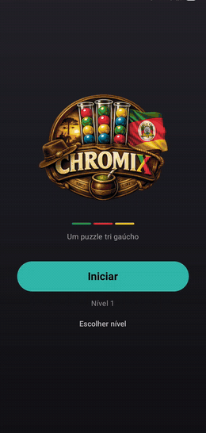
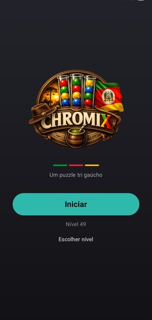
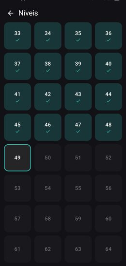
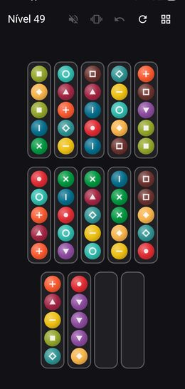
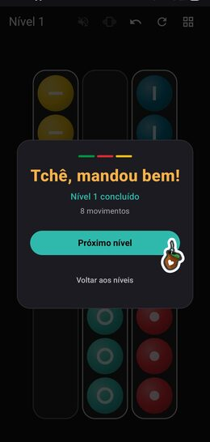

<div align="center">

# Chromix

**Puzzle Ball Sort para Android, com identidade gaúcha.**

Organize bolinhas coloridas em frascos até cada frasco conter uma única cor.
Fases infinitas geradas na hora, todas validadas por um solver antes de chegar em você.

[](https://kotlinlang.org)
[](https://developer.android.com/jetpack/compose)
[](https://www.android.com)
[](https://github.com/br1ansouza/Chromix/releases)



</div>

## Telas

<table>
  <tr>
    <td align="center"><br /><sub><b>Início</b><br />Logo e nível atual</sub></td>
    <td align="center"><br /><sub><b>Níveis</b><br />Progressão linear, sem limite</sub></td>
    <td align="center"><br /><sub><b>Tabuleiro</b><br />12 cores, marcador por forma</sub></td>
    <td align="center"><br /><sub><b>Vitória</b><br />Contagem de movimentos</sub></td>
  </tr>
</table>

## Download

APK pronto na página de [**Releases**](https://github.com/br1ansouza/Chromix/releases). Baixe o `.apk` da versão mais recente e instale no Android 7.0 ou superior (permita "fontes desconhecidas").

- 100% offline, sem anúncios, sem contas, sem música de fundo
- Fases infinitas geradas proceduralmente, sempre solucionáveis, com dificuldade crescente
- Paleta "pôr-do-sol no pampa", detalhes do RS (bandeira, exclamações tchê)
- Feedback tátil (vibração) e sonoro (efeitos curtos), cada um com toggle próprio
- Kotlin + Jetpack Compose, arquitetura MVVM

## Como jogar

Toque num frasco para levantar a bolinha do topo (click + vibração sutil), depois toque no destino. O movimento vale se o destino estiver vazio ou com bolinha da mesma cor no topo (e não estiver cheio). A bolinha voa em arco até o lugar. Movimento inválido dá shake no frasco; frasco completo fica travado. Se o tabuleiro ficar sem saída, o jogo avisa pra desfazer ou reiniciar. Vença quando todo frasco estiver vazio ou completo com uma cor só: "Bah, tri massa!".

- **Undo** e **reset** ilimitados, sem custo
- **Tubo extra de emergência**: segure o botão de vibração por 3 segundos (1 por fase)
- **Toggles no HUD**: som e vibração, salvos entre sessões
- **Tela de níveis**: progressão linear, concluídos com check, nível atual destacado
- **Dificuldade**: 4→12 cores (+1 a cada 6 níveis), mistura progressiva (bolinhas nascem mais agrupadas no começo), capacidade 4→6 a partir do 21, sempre 2 tubos vazios

## O problema interessante: gerar fase que sempre tem solução

Ball Sort é fácil de programar e difícil de gerar bem. A primeira versão usava a abordagem
comum de embaralhar a partir do estado resolvido aplicando movimentos inversos. O resultado
media mal: em níveis altos, 11 dos 12 tubos terminavam com fundo de cor única, então a fase
parecia montada pela metade.

A segunda tentativa foi preencher tudo aleatoriamente. Aí apareceu o problema oposto: com
1 tubo vazio e o tabuleiro bem misturado, 30 de 30 tabuleiros gerados eram **impossíveis**.

A versão atual junta as duas coisas com um verificador no meio:

1. Distribui todas as bolinhas de forma aleatória, com semente determinística pelo número do nível.
2. Roda o `Solver` (busca em profundidade iterativa, memoização por estado canônico, orçamento de 200 mil expansões).
3. Rejeita e regenera se for insolúvel, ou se for trivial demais (fundo monocromático de 3 ou mais, poucas transições de cor).

Um detalhe que passou despercebido por muito tempo: a solvabilidade era provada movendo
**uma bolinha por vez**, mas o jogador move o **grupo inteiro** de cores iguais. Semânticas
diferentes, garantia furada. Hoje o solver usa exatamente a mesma regra de movimento do jogo.

Geração roda em `Dispatchers.Default`, com média de 9 ms e pior caso medido de 152 ms, então
não existe tela de carregamento. Os testes unitários pegam a solução que o solver encontrou e
reexecutam ela nas fases 1 a 60, garantindo que continuam vencíveis a cada mudança.

## Stack

| Camada | Tecnologia |
|--------|------------|
| Linguagem | Kotlin 2.0 |
| UI | Jetpack Compose (Compose Animation, navigation-compose) |
| Arquitetura | MVVM (ViewModel + StateFlow) |
| Persistência | DataStore (Preferences) |
| Haptics | `VibrationEffect` (API 26+) com fallback legado |
| Som | `SoundPool` (efeitos curtos, baixa latência) |
| Build | Gradle 8.11 (Kotlin DSL), AGP 8.7, minSdk 24, targetSdk 35 |

## Estrutura

```
app/src/main/java/com/br1ansouza/chromix/
├── data/        # GamePreferences (DataStore: nível, recorde, som, vibração)
├── domain/      # Modelos, regras e gerador de fases (puro Kotlin, testável na JVM)
├── ui/
│   ├── home/    # Tela inicial: logo, listras do RS, botão Iniciar
│   ├── game/    # Tabuleiro Canvas, animações (voo Bézier, shake, pulso, lift),
│   │            # HUD, card de vitória, paleta com marcadores p/ daltonismo
│   ├── levels/  # Grade de níveis (9999+ exibidos, geração sob demanda)
│   ├── haptics/ # GameHaptics (seleção 10ms, válido 12ms, erro 30ms,
│   │            # tubo completo 40ms, vitória em waveform duplo)
│   ├── sound/   # GameSounds (click de seleção, chime de vitória)
│   └── theme/   # Tema dark fixo com acentos da paleta RS
└── viewmodel/   # GameViewModel (estado, undo, eventos)
```

O domínio (`domain/`) é Kotlin puro, sem dependência de Android, então roda direto na JVM
nos testes. É onde vivem as regras de movimento, o gerador e o solver descritos acima.

## Build

Pré-requisitos: JDK 17+ e Android SDK (platform 35). Defina o caminho do SDK em `local.properties`:

```properties
sdk.dir=/caminho/para/android-sdk
```

Ou abra o projeto no Android Studio (que gera esse arquivo sozinho) e rode pelo botão Run.

Pela linha de comando:

```bash
# APK de debug (instalável direto, assinado com a chave de debug)
./gradlew :app:assembleDebug
# saída: app/build/outputs/apk/debug/app-debug.apk

# instalar num aparelho com depuração USB ligada
adb install -r app/build/outputs/apk/debug/app-debug.apk

# testes unitários (regras + solvabilidade do gerador)
./gradlew :app:testDebugUnitTest
```

> WSL2 não enxerga USB: use o `adb.exe` do Android SDK do Windows (ex.:
> `/mnt/c/Users/<user>/AppData/Local/Android/Sdk/platform-tools/adb.exe`) apontando
> para o APK com caminho Windows.

### APK de release (assinado)

Copie `keystore.properties.example` para `keystore.properties` (gitignored) apontando para sua keystore e rode:

```bash
./gradlew :app:assembleRelease
# saída: app/build/outputs/apk/release/app-release.apk (minificado + assinado)
```

Sem o `keystore.properties`, o release sai sem assinatura. Os APKs publicados em [Releases](https://github.com/br1ansouza/Chromix/releases) são builds de release assinados.

## Créditos

- Efeitos sonoros: [Pixabay](https://pixabay.com/sound-effects/) (royalty-free)
- Logo: arte própria com temática gaúcha
